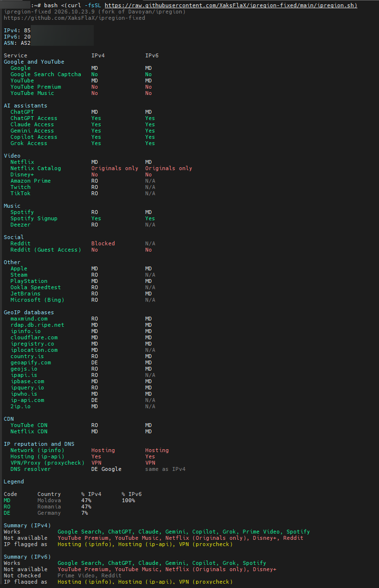

# ipregion-fixed

**English** | [Русский](README.ru.md)

A bash script for determining your IP geolocation using various GeoIP services and popular websites.  
This is a fork of [Davoyan/ipregion](https://github.com/Davoyan/ipregion) (itself a fork of the [original script](https://github.com/vernette/ipregion/))
that fixes proxy leaks and unattended package installs, adds availability checks for ChatGPT, Claude, Gemini, Copilot,
Grok and Netflix, brings back the Disney+ check of the original script, shows whether the IP is flagged as hosting or VPN
and which DNS resolver it uses, ends with a short summary and runs the checks in parallel. Details below.

## Usage
Run directly from GitHub:
```bash
bash <(curl -fsSL https://raw.githubusercontent.com/XaksFlaX/ipregion-fixed/main/ipregion.sh)
```
Safer: download a specific commit, check it, then run it as a regular user:
```bash
curl -fsSL https://raw.githubusercontent.com/XaksFlaX/ipregion-fixed/<commit>/ipregion.sh -o ipregion.sh
less ipregion.sh
bash ipregion.sh
```

### Output example

A VPS in Moldova, version 2026.10.23.9 (IP addresses, ASN and host name are hidden):



How to read it:

- **Blocks** — Google and YouTube, AI assistants, Video, Music, Social, Other, then GeoIP databases, CDN and IP reputation.
- **Columns** — the same check over IPv4 and IPv6. `N/A` in the IPv6 column usually means the service has no IPv6.
- **Country codes** — where the service thinks the IP is. Here services disagree: about half see Moldova (`MD`), half Romania (`RO`).
- **YouTube Premium / Music `No`** — Google sees Moldova, where they are not offered.
- **ChatGPT / Claude / Gemini / Copilot Access `Yes`** — all four work from this IP.
- **Netflix Catalog `Originals only`** — Netflix shows only its own titles here.
- **Disney+ `No`** — Disney refuses this IP ("Forbidden location").
- **Reddit `Blocked`** — Reddit blocks this IP (typical for hosting); Guest Access `No`: even the site does not open.
- **The second block** — GeoIP databases; **YouTube/Netflix CDN** — the country of the node that serves video.
- **[Network block](#ip-reputation-and-dns)** — all three sources see a hosting address, proxycheck also calls it a VPN;
  the DNS resolver is Google in Germany (checked once, so the IPv6 column says `same as IPv4`).
- **Legend** — share of services that see each country, counted over country codes only.
- **[Summary](#summary)** — what works and what does not, per IP version. Here two kinds of refusals are visible:
  YouTube Premium and Music because of the country (Google sees Moldova), Netflix, Disney+ and Reddit because of the
  hosting/VPN address. On IPv6 Reddit and Prime Video are `Not checked`: they have no IPv6.

## What is new in this fork

### Availability checks

| Row | Values | How it is decided |
|---|---|---|
| ChatGPT Access | `Yes` / `No` | `api.openai.com` answers `403 unsupported_country_region_territory` where ChatGPT is not offered |
| Claude Access | `Yes` / `No` | without a key the Anthropic API answers `401` in supported regions and `403 Request not allowed` elsewhere |
| Netflix Catalog | `Full` / `Originals only` | two licensed titles are opened; if both are missing while a control title opens, Netflix shows only its own titles (region or proxy detection) |
| Disney+ | country / `No` | Disney+ device registration reports whether the location is supported and which country it sees; `No` also when Disney refuses this IP with "Forbidden location" (seen for hosting IPs even in countries where Disney+ works) |
| Gemini Access | `Yes` / `No` | the country Google sees, looked up in Google's [list of regions where the Gemini API is available](https://ai.google.dev/gemini-api/docs/available-regions) (downloaded on each run) |
| Copilot Access | `Yes` / `No` | `copilot.microsoft.com` is behind Cloudflare, which answers `error code: 1009` (country banned) where Copilot is not offered |
| Grok Access | `Yes` / `No` | without a key the xAI API answers `401` where Grok works and `403` "This service is not available in your region." elsewhere |

Disney+ and Gemini come from the [original script](https://github.com/vernette/ipregion/) (both were dropped in Davoyan's fork):
Disney+ uses the same request, Gemini the same idea (Google's region list, names compared word by word) without the extra
downloads of CLDR names. Perplexity is not checked: its API answers the same from Russia and from the Netherlands,
and its site is behind bot protection, so there is no regional signal.

### IP reputation and DNS

Most refusals (Reddit, Disney+, Netflix showing only its own titles) are not about the country but about the IP being
a hosting or VPN address. A block after the CDN rows shows how the IP is seen:

| Row | Values | Source |
|---|---|---|
| Network (ipinfo) | `Hosting` / `ISP` / `Business` / `Education`, then `VPN`, `Proxy`, `Tor`, `Relay` if flagged, e.g. `Hosting, VPN` | ipinfo.io: the same free widget answer as the ipinfo.io row, requested once per IP version and over that version (`v6.ipinfo.io` for IPv6): ipinfo answers freely only about the address a request comes from, lookups of other addresses have a small daily quota |
| Hosting (ip-api) | `Yes` / `No` | ip-api.com |
| VPN/Proxy (proxycheck) | `No` / `VPN` / `Proxy` / … | proxycheck.io (free: 100 queries a day per IP) |
| DNS resolver | country and provider, e.g. `DE Google` | edns.ip-api.com: which resolver looked up a random name. The script's own DoH is bypassed here, so this is the system resolver (or the proxy's one with `-p`). Checked once: the IPv6 column says `same as IPv4` (edns.ip-api.com has no IPv6, so with `-6` it is `N/A`) |

### Summary

After the legend the script prints a short verdict for each IP version:

```text
Summary (IPv4)
Works           Google Search, YouTube Premium, ChatGPT, Claude, Gemini, Copilot, Grok, Netflix, Disney+, Spotify
Not available   Reddit
IP flagged as   Hosting (ipinfo), Hosting (ip-api), VPN (proxycheck)
```

`Not checked` lists the services that gave no answer (N/A, Timeout, RateLimited).

### A reason instead of `N/A`

When a check gets no answer, the row shows why:

- `Blocked` — the service answered HTTP 403 (for Reddit: its "blocked by network security" page, typical for datacenter IPs);
- `RateLimited` — HTTP 429, too many requests from this IP;
- `Timeout` — no answer in time;
- `N/A` — anything else (network error, changed API).

### Faster

Checks run 6 at a time (`-P N` to change, `-P 1` for one by one). On our servers a full run takes 12–19 s instead of
22–47 s one by one, with the same results.

The version is printed in the header and in JSON (`script_version`).

### CDN rows are back in the table

`YouTube CDN` and `Netflix CDN` were checked on every run but hidden. Now they are printed after the GeoIP services.
They show the country of the video node that serves this IP (useful to see how far the server is from it),
so they are not counted in the legend.

## What is fixed

Compared to [Davoyan/ipregion@a85abbf](https://github.com/Davoyan/ipregion/blob/a85abbf739e07b1162bee066d756be1e4b9bfcc0/ipregion.sh):

- **SOCKS5 proxy no longer leaks.** Every request goes through one helper, so `-p` and `-i` apply everywhere
  (before, the DoH check, Spotify Signup, Bing, Steam, PlayStation, Amazon Prime, Google Play and restcountries.com bypassed them).
  The proxy is used as `socks5h://`, so DNS is resolved by the proxy as well; DoH is skipped when a proxy is set.
- **No unattended package installs.** Without a terminal (`ssh host 'bash -s'`, cron) the old script skipped the
  "install?" prompt and ran `apt install -y` as root. Now it stops and prints the command to run by hand.
  In a terminal it shows the exact install command first and asks (the default answer is no).
- **Safer installs:** no `NEEDRESTART_MODE=a` (services are not restarted silently), `column` comes from
  `bsdextrautils`/`bsdmainutils` instead of reinstalling `util-linux`, and `pacman -S --needed` instead of a partial `-Syy` upgrade.
- **External IP is confirmed by two different services** (`ifconfig.me` was listed twice; the second one is now `icanhazip.com`).
- **Fixed lookups:** Amazon Prime blocking detection, 2ip.io request, ipapi.is (the API now returns only the country name),
  Bing market codes such as `XL` and `WW` (falls back to login.live.com), YouTube CDN node names like `tzfraa-cd`.
- **Reddit shows `Blocked`** instead of an empty value when Reddit answers with its block page. From residential IPs it shows the country.
- **ipapi.co is excluded:** it answers `429 RateLimited` to datacenter IPs.
- The legend counts only country codes, so `Yes`, `No`, `Blocked` and similar values never appear as "countries".
- The temporary files are removed in every mode; dead code is gone.
- [ShellCheck](https://www.shellcheck.net/) runs on every push (GitHub Actions).

## What Davoyan's fork added

Compared to the original script, [Davoyan/ipregion](https://github.com/Davoyan/ipregion) includes several improvements and fixes:

- **Improved IPv6 detection** — previously unreliable in some cases.  
- **Fixed freezes** on certain services.  
- **Adjusted output table alignment** for better readability.  
- **Separated YouTube and Google checks** — sometimes show different regions.  
- **Correct detection of Google China (CN) region**.  
- **Added support for additional services**: 2ip.io, Youtube Music, Bing, and Amazon Prime.  
- **ASN detection using MaxMind database** — same as [IPQuality](https://github.com/xykt/IPQuality/).  
- **CDN services removed from the default group** — can be checked separately if needed.  
- **Enhanced human-readable output** with country name decoding and percentage calculations.  
- **Country names + percentage stats**: alongside ISO codes, shows country names and percentage distribution across services
- **Fixed minor bugs**, e.g., inability to interrupt the script during execution.

The list above is quoted from Davoyan's README. In this fork the CDN rows are shown in the full table again (see above).

## Main features

- Checks your IP geolocation using multiple public GeoIP APIs
- Results from both "primary" GeoIP services and popular web services (YouTube, Netflix, Twitch, etc.)
- Supports both IPv4 and IPv6 (can test separately)
- SOCKS5 proxy and custom network interface support
- JSON output for automation and integration
- Color-coded, easy-to-read table output

## Dependencies

- bash
- curl
- jq
- `column`: util-linux, or bsdextrautils / bsdmainutils on Debian and Ubuntu

If something is missing, the script shows the exact install command and asks before running it.

## Country codes

The script outputs country codes in ISO 3166-1 alpha-2 format (e.g., RU, US, DE).  
In the **human-readable output**, the script also shows the **full country name** and **percentage distribution**.  

For manual lookup of codes, you can use the official ISO website: [https://www.iso.org/obp/ui/#search/code/](https://www.iso.org/obp/ui/#search/code/)

### Common use cases

```bash
# Options also work when running straight from GitHub
bash <(curl -fsSL https://raw.githubusercontent.com/XaksFlaX/ipregion-fixed/main/ipregion.sh) --group primary

# Show help message
bash ipregion.sh --help

# Check all services with default settings
bash ipregion.sh

# Check only GeoIP services
bash ipregion.sh --group primary

# Check only CDN services
bash ipregion.sh --group cdn

# Check only hosting/VPN flags and the DNS resolver
bash ipregion.sh --group network

# Check only popular web services
bash ipregion.sh --group custom

# Test only IPv4
bash ipregion.sh --ipv4

# Test only IPv6
bash ipregion.sh --ipv6

# Use SOCKS5 proxy
bash ipregion.sh --proxy 127.0.0.1:1080

# Use a specific network interface
bash ipregion.sh --interface eth1

# Set custom curl request timeout in seconds
bash ipregion.sh --timeout 20

# Check services one by one instead of 6 at a time
bash ipregion.sh --parallel 1

# Output result as JSON
bash ipregion.sh --json

# Enable verbose logging
bash ipregion.sh --verbose
```

All options available in the help message (`-h, --help`) can be used and combined.

## Options

```
Usage: ipregion.sh [OPTIONS]

IPRegion — determines your IP geolocation using various GeoIP services and popular websites

Options:
  -h, --help           Show this help message and exit
  -v, --verbose        Enable verbose logging
  -j, --json           Output results in JSON format
  -g, --group GROUP    Run only one group: 'primary', 'custom', 'cdn', 'network', or 'all' (default: all)
  -t, --timeout SEC    Set curl request timeout in seconds (default: 6)
  -4, --ipv4           Test only IPv4
  -6, --ipv6           Test only IPv6
  -p, --proxy ADDR     Use SOCKS5 proxy (format: host:port)
  -i, --interface IF   Use specified network interface (e.g. eth1)
  -P, --parallel N     Check N services at a time (default: 6, 1 = one by one)
      --no-update-check  Do not check GitHub for a newer version of this script

Examples:
  ipregion.sh                     # Check all services with default settings
  ipregion.sh -g primary          # Check only GeoIP services
  ipregion.sh -g custom           # Check only popular websites
  ipregion.sh -g cdn              # Check only CDN endpoints
  ipregion.sh -g network          # Check only hosting/VPN flags and the DNS resolver
  ipregion.sh -4                  # Test only IPv4
  ipregion.sh -6                  # Test only IPv6
  ipregion.sh -p 127.0.0.1:1080   # Use SOCKS5 proxy
  ipregion.sh -i eth1             # Use network interface eth1
  ipregion.sh -j                  # Output result as JSON
  ipregion.sh -v                  # Enable verbose logging
  ipregion.sh -P 1                # Check services one by one
```

## Versions and caching

The first line of the output shows the version, e.g. `ipregion-fixed 2026.10.23.1`. Every change of `ipregion.sh` bumps
`SCRIPT_VERSION` (`YYYY.MM.DD.N`), and GitHub Actions fails the build if it was not bumped.

GitHub caches files under `raw.githubusercontent.com/.../main/...` for up to 5 minutes, so right after an update
the `main` link may still serve the previous version. A link to a specific commit is never stale.

While the services are checked, the script reads the latest version from GitHub (the first 2 KB of `ipregion.sh` on `main`).
If it is newer, the output ends with "A newer version is available" and the command to run it; JSON gets `latest_version`.
If GitHub is unreachable nothing is printed. `--no-update-check` turns this off.

## License

MIT, see [LICENSE](LICENSE). Copyright of the original script: Nikita Skryabin (vernette).
